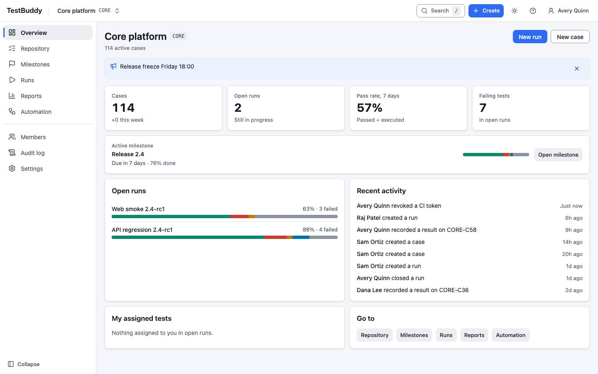
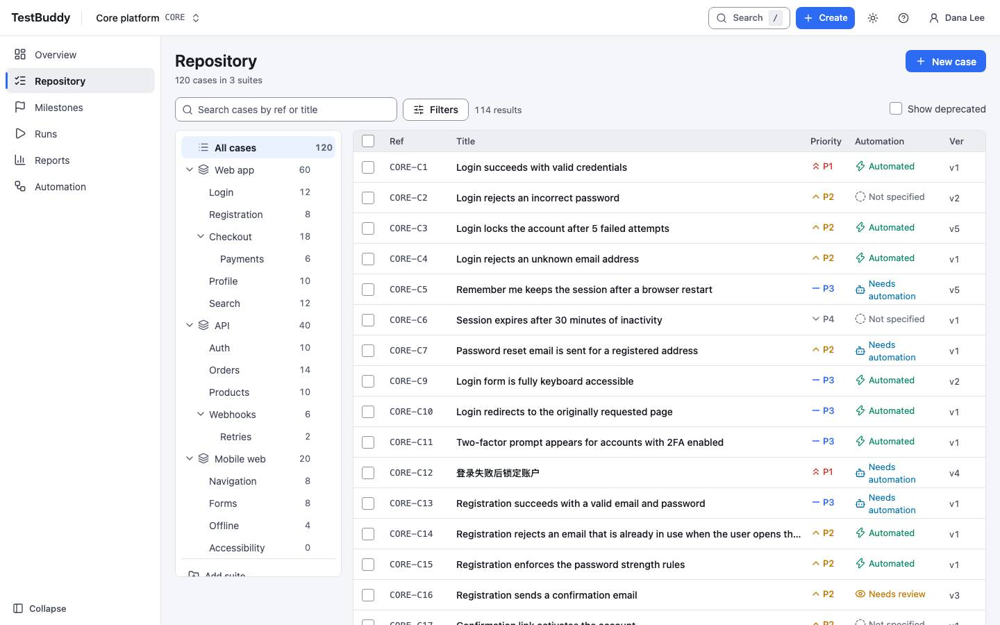
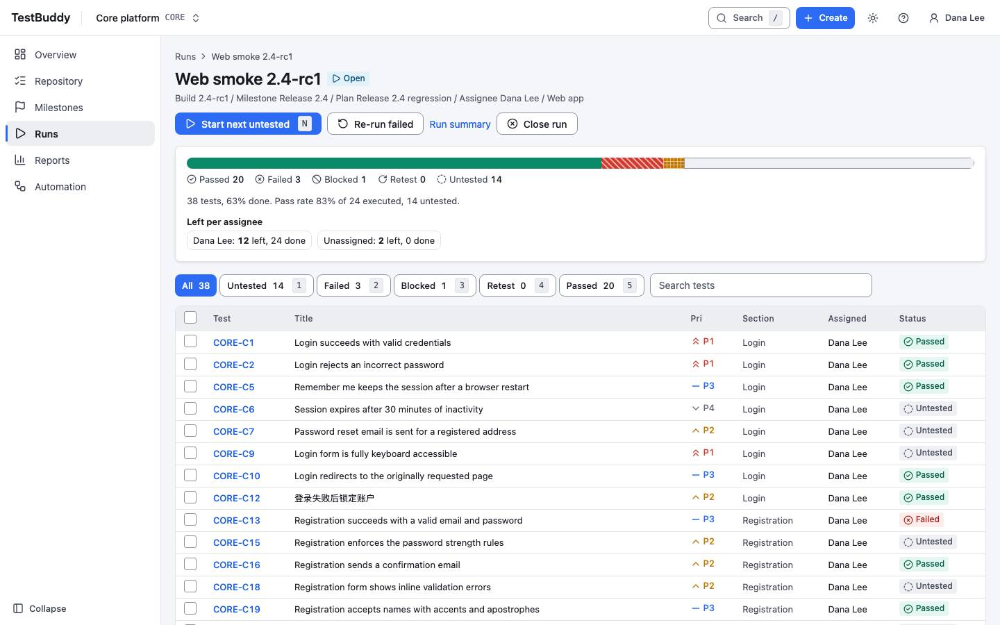
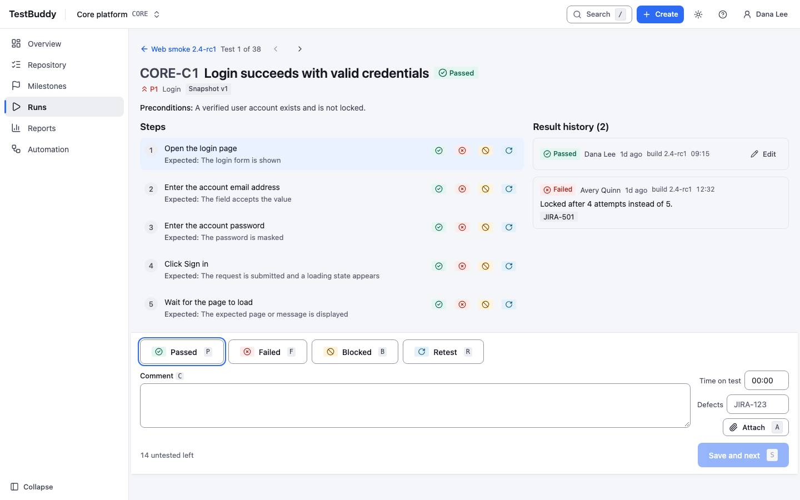

# TestBuddy

An open-source test management app: organise test cases, plan and execute test runs, track milestones, and report progress. Apache-2.0.

> Original idea and specification by maxlinux (https://github.com/maxlinux/testbuddy).

[](https://github.com/StillNotBald/testbuddy/blob/main/LICENSE) [](https://github.com/StillNotBald/testbuddy/actions/workflows/ci.yml)

Repository: https://github.com/StillNotBald/testbuddy

## Status

**Milestone 0: a UI on a mock local database.** Read this before you try it.

- There is **no server yet**. All data lives in your browser (local storage), seeded from deterministic fixtures. Edits persist in that browser only. Nothing is shared between users or machines.
- Sign-in is a demo account picker (demo password `demo-only`, API token prefix `tb_demo_`). There is no real authentication.
- The PocketBase backend (pinned v0.40.6) arrives in Milestone 1 behind the same typed service interfaces. The approved UI stays as it is.
- An **MCP server** for AI agents is built (`/api/mcp` over HTTP, plus a stdio server for Claude Desktop): 15 tools, token auth, the same role rules, an audit entry per write. In M0 it runs on its own server-side demo dataset, separate from your browser. See [`docs/mcp/README.md`](docs/mcp/README.md).
- The REST API, CI result ingestion and integrations are specified in `docs/api/openapi.yaml` and `docs/implementation-plan.md`. They are **not built**.

## What works now

Everything below runs on mock data. Role gating (admin, manager, tester, viewer) is enforced in the UI.

- **Projects:** project list, create project dialog, first-run empty state, optional sample project.
- **Repository:** suite and section tree, virtualised case list with filters and bulk actions, case inspector, case editor (steps, expected results, version notes), version history with diff.
- **Runs:** run list, create run from a filtered set, run detail with progress, test execution view with result bar, per-step results, result history, keyboard shortcuts.
- **Plans and milestones:** plan list and detail (reached from Runs), milestone list and detail with progress.
- **Reports:** reports index, run report, milestone report.
- **Automation (screens only):** mappings, executions and token management on mock data. No CI endpoint exists to post to.
- **Admin:** members and roles, audit log, project settings.
- **App shell:** project switcher, global search, light and dark theme, keyboard help, built-in guided tour, "How it works" page, `llms.txt`.
- **TestRail case import:** an XML/CSV parser and dry-run planner exist as a library with unit tests. There is no import screen yet.
- **Health route:** `GET /api/health`.

## Quick start

Requirements: Node 24 (`fnm use 24` or `nvm use 24`) and npm.

```bash
npm ci
npm run dev        # http://localhost:3000
```

Open the app and pick a demo account on the sign-in page. All users are fictional, with an `@example.test` address:

| User | Role in "Core platform" |
|---|---|
| Avery Quinn | admin |
| Raj Patel | manager |
| Dana Lee, Sam Ortiz | tester |
| Mia Chen | viewer |
| Pat Doe | disabled account (cannot sign in) |

**Busy team (heavy seed).** For a large dataset, open the app with `?demo=heavy` or choose it in the **Reset demo data** dialog (user menu). Reset demo data replaces everything in the browser with the original fixtures.

It has 6 projects (1 archived), 22 users, about 1,300 cases with version history, 14 milestones, 11 plans, 38 runs with about 2,900 results over 8 weeks, 36 CI builds and about 660 audit rows (about 3.8 MB of browser storage). `NEXT_PUBLIC_DEMO_SEED=heavy` makes it the default.

Optional: `cp .env.example .env.local`. The defaults use mock data and need nothing else.

## Scripts

| Command | What it does |
|---|---|
| `npm run dev` | Next.js dev server on :3000 |
| `npm run build` / `npm start` | Production build (standalone output) / `next start` |
| `npm run start:standalone` | Run the production build on :3100, as deployed (run `npm run build` first) |
| `npm run typecheck` | `tsc --noEmit` |
| `npm run lint` / `npm run format` | ESLint / Prettier |
| `npm test` / `npm run test:watch` | Vitest and Testing Library (jsdom) |
| `npm run e2e` | Playwright against an already running app (`BASE_URL`, default http://127.0.0.1:3100). Run `npx playwright install chromium` once |
| `npm run rtm:verify` | Requirements and traceability matrix consistency gate |
| `npm run render:check` | Phone (390px) and desktop screenshots, light and dark, with an axe scan. Needs a running build |
| `npm run user-guide:shots` / `user-guide:pdf` | Build the user-guide screenshots and PDF |
| `npm run pb:download` / `pb:start` / `pb:typegen` | PocketBase binary and server (used from M1). `pb:typegen` is a stub until M1 |

## Architecture

- **Frontend:** Next.js 16 (App Router), React 19, TypeScript, Tailwind CSS 4, Radix primitives (shadcn-style components kept in-repo), TanStack Query and Table.
- **Service layer:** screens never touch storage directly. They call typed services (`src/services/interfaces.ts`). Today a mock implementation (`src/services/mock/`) runs on a browser-storage database. In M1 a PocketBase implementation (`src/services/pocketbase/`) replaces it behind the same interfaces. See `src/services/README.md`.
- **Backend (planned):** PocketBase v0.40.6, with collections, rules and hooks in `pb_migrations/` and `pb_hooks/` (empty until M1). Next proxies `/api/*` and `/_/*` to it.
- **Decisions:** [ADR 0001](docs/adr/0001-pocketbase-backend-nextjs-frontend.md) stack, [ADR 0002](docs/adr/0002-api-first-design-testrail-reference.md) API-first, [ADR 0003](docs/adr/0003-own-client-api-and-agent-access.md) own clients, agent access.

## Repo map

| Path | Contents |
|---|---|
| `src/app/` | Routes (App Router) |
| `src/components/` | Screens and UI primitives |
| `src/services/` | Service interfaces, mock database, PocketBase stubs |
| `src/lib/` | Permissions, hotkeys, TestRail importer, utilities |
| `src/guide/` | In-app built-in guided tour content |
| `e2e/` | Playwright specs |
| `scripts/` | RTM verifier, render check, PocketBase download, user-guide build |
| `docs/` | BRD, design spec and mockups, API contract, schema, ADRs, journey maps, user guide |
| `requirements/` | Requirements (R-IDs) and the traceability matrix |
| `sprint-log/`, `testing-log/`, `UAT-log/` | Build receipts, test evidence, acceptance testing |

## Screenshots

Desktop, light theme, from render check [`testing-log/2026-11-04_render-check-fe4ce44/`](testing-log/2026-11-04_render-check-fe4ce44/README.md). Screens have changed since that run.

| | |
|---|---|
|  |  |
| Project overview | Case repository |
|  |  |
| Run detail | Test execution |

## Roadmap

From [`docs/implementation-plan.md`](docs/implementation-plan.md). Requirement status is tracked in [`requirements/TRACEABILITY.md`](requirements/TRACEABILITY.md).

| Milestone | Scope | State |
|---|---|---|
| M0 | UI prototype on a mock local database | Built; owner review gate pending |
| M1 | Working foundation: PocketBase v0.40.6, auth, projects, roles, audit, all collections | Not started |
| M2 | Case repository on the server: versions, import, tags, deletion rules | Not started |
| M3 | Test execution: plans, runs, results, attachments, dashboard | Not started |
| M3b | MCP server for agent access | Built on demo data (M0); PocketBase-backed in M1, OAuth for claude.ai connectors later |
| M4 | Automation APIs, JUnit and Robot importers, TestRail import | Not started |
| M5 | Reporting trends, Jira, Xray export, webhooks, CSV export | Not started |
| M6 | AI preparation: requirements coverage, corpus export, documentation, handover | Not started |

## Contributing

Read [CONTRIBUTING.md](CONTRIBUTING.md) and the [Code of Conduct](CODE_OF_CONDUCT.md). Every change traces to an R-ID in `requirements/REQUIREMENTS.md`; update the RTM in the same change and run `npm run rtm:verify`. Report vulnerabilities as described in [SECURITY.md](SECURITY.md).

## Acknowledgements

Original idea and specification by maxlinux (https://github.com/maxlinux/testbuddy). The spec in `docs/` descends from that work.

## Licence

Apache-2.0, see [LICENSE](LICENSE). Attributions are in [NOTICE](NOTICE).

### Third-party notices

- `@axe-core/playwright` (MPL-2.0): development dependency for accessibility checks only; not shipped in the app.
- `sharp` / libvips (LGPL-3.0): optional binary installed by Next.js on its own; not redistributed by this repository.
- `caniuse-lite` (CC-BY-4.0): browser-support data used by build tooling.
