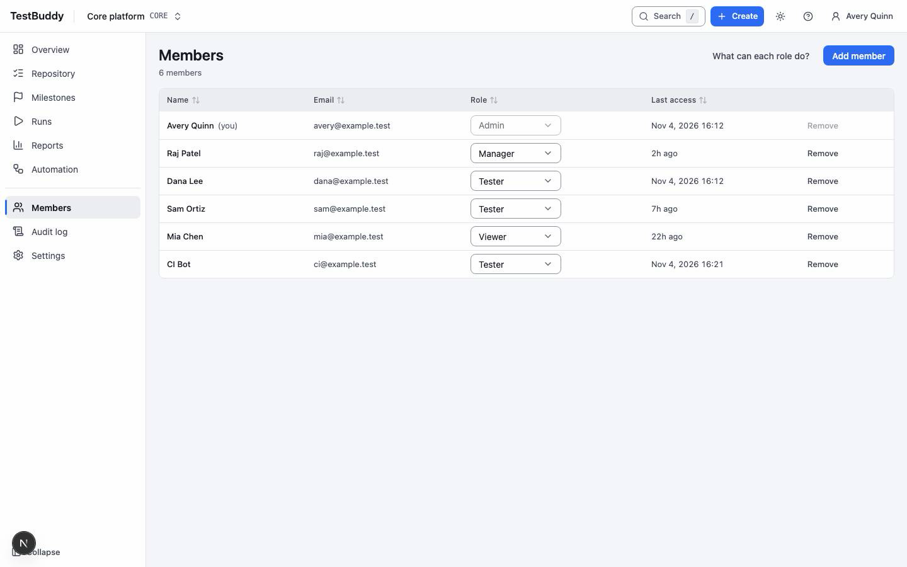
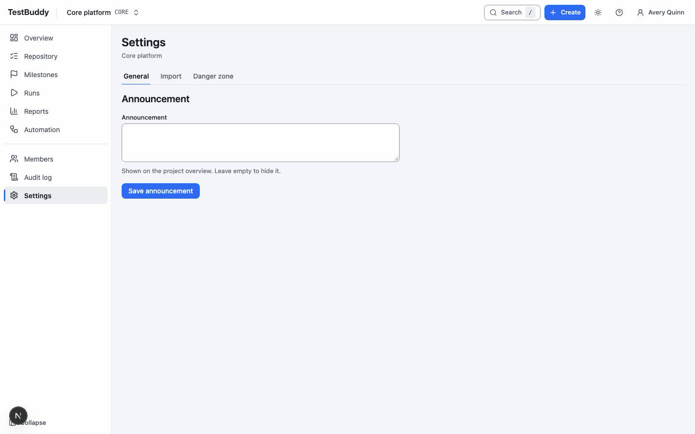

# Admin

> DRAFT. Screens are placeholders and steps may change.

Admins manage people, access and project settings.

## Members and roles

Open Members to see everyone on the project. Add a person by email and choose a role.

| Role | Can do |
|---|---|
| Viewer | Read cases, runs and reports |
| Tester | Write cases, record results |
| Manager | Plans, milestones, exports, mappings |
| Admin | Members, tokens, audit log, settings |

## Audit log

The audit log lists who changed what and when. Filter by person, action or item.

## Settings

Settings has the general project details, the announcement banner and import. Archiving a project makes it read-only for everyone.

