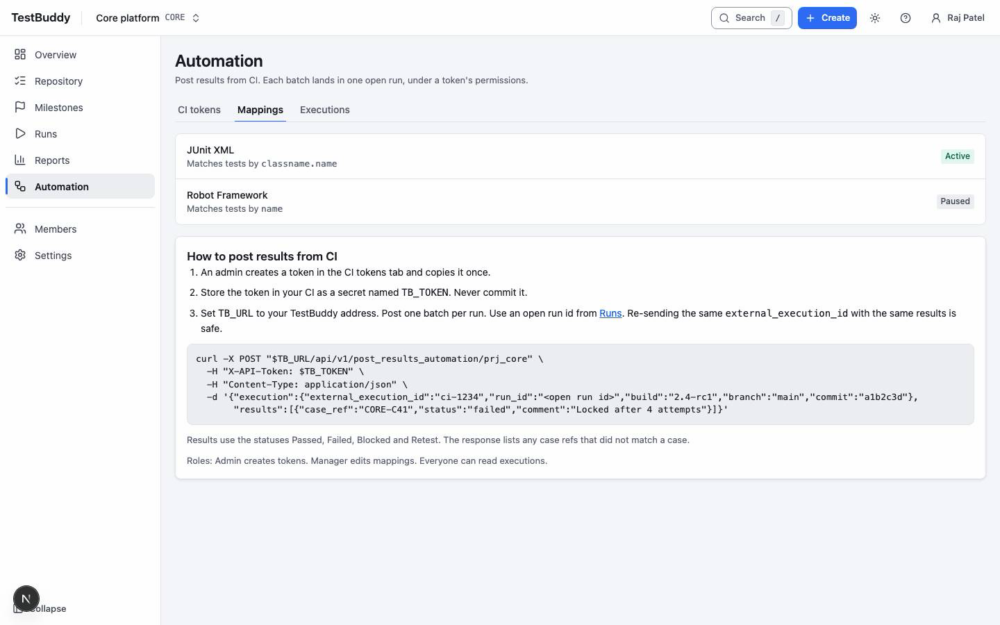

# CI

> DRAFT. The posting endpoint and examples will be added once the automation API is wired. Screens are placeholders.

CI jobs post automated results into TestBuddy so they appear beside manual ones.

## Set it up

1. An admin opens Automation and the Tokens tab, then creates a token. It is shown once; store it in your CI secrets.
2. Open the Mappings tab. A mapping connects a CI test name to a case, so results land on the right case.
3. Run your job. The Executions tab lists every upload and its outcome.

## Check what arrived

Open an execution to see which results matched a case and which did not. Unmatched names are fixed by adding a mapping.

## Good practice

- Use one token per pipeline so you can revoke it without touching the others.
- Keep test names stable. Renaming a test breaks its mapping.
