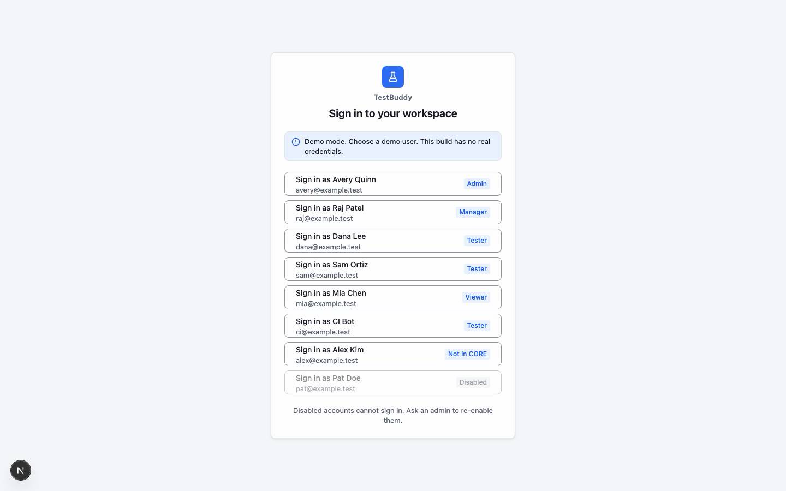
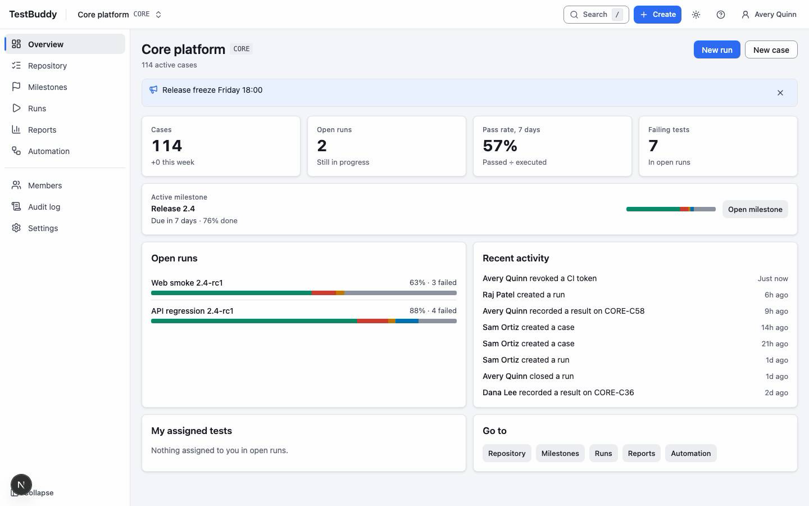

# Getting started

> DRAFT. Screens are placeholders; screenshots will be captured after the mockups are approved.

## Sign in

Open TestBuddy in your browser and sign in. In the demo build you choose a demo user; there are no real credentials.

## Find your way around

The top bar holds the project switcher, search (press `/` or `Cmd/Ctrl+K`), a Create menu, the theme toggle, help and your user menu. The sidebar lists the project areas: Overview, Repository, Milestones, Plans, Runs, Reports and Automation. Admins and managers also see Members, Audit log and Settings.

## Take the in-app guide

Open the help menu (the question mark) or your user menu and choose Take the guide. The guide asks what you want to do and walks you through only that: one ringed element per step. You can close it at any time with Esc, and it remembers your choice next time.

Goals in the guide:

1. Write my first test case
2. Run a test cycle
3. Record results fast (keyboard)
4. See how a release is going
5. Connect CI results
6. Invite my team

The same content is on the How it works page (`/how-it-works`) and in `/llms.txt` for AI assistants.

## Keyboard shortcuts

Press `?` to see every shortcut. Single-key shortcuts (for example `P` for Passed) can be switched off in the user menu if they clash with your assistive technology.
