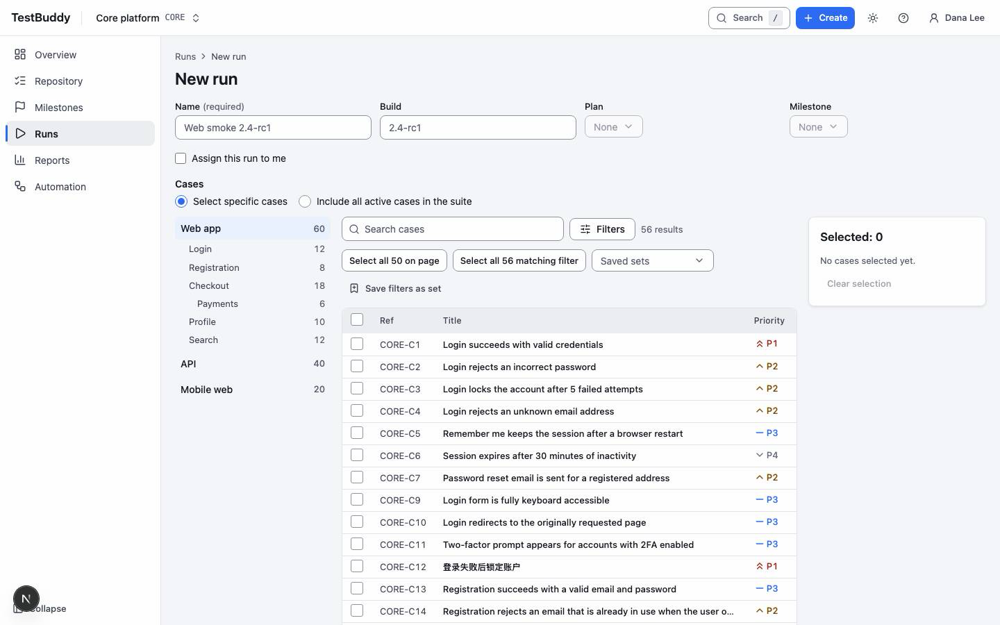
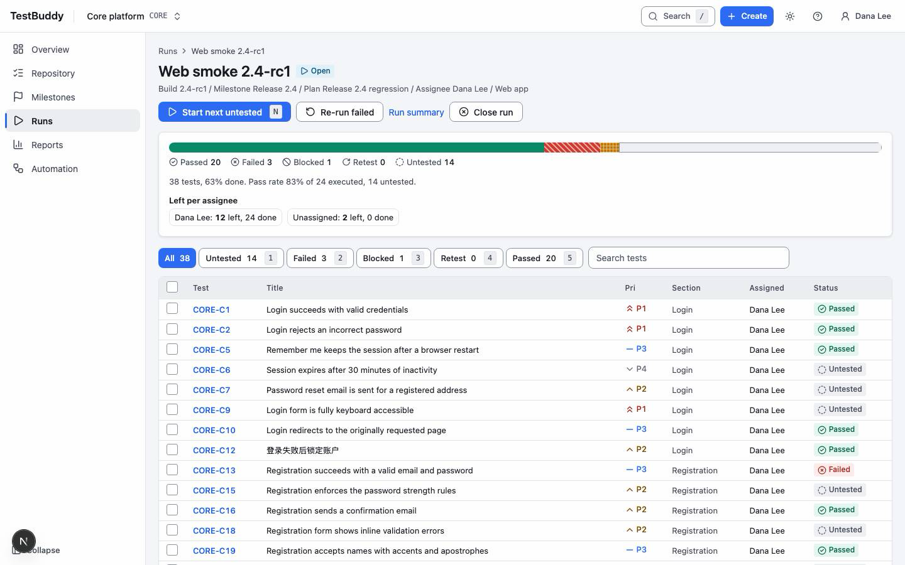

# Test lead

> DRAFT. A test lead usually has the Manager role. Screens are placeholders and steps may change.

Leads plan a test cycle, get it executed and close it.

## Plan a cycle

1. Open Runs and choose New run.
2. Pick the cases to include. Use the filters (section, priority, tag) and check the count.
3. Optionally attach the run to a plan or milestone.
4. Create the run. Each case is frozen at its current version.

## Follow progress

The run page shows a progress bar with counts of Passed, Failed, Blocked, Retest and Untested. Filter the test list by status or assignee to find what is left.

## Assign and unblock

Assign tests to people from the run page. Blocked and Retest tests are the ones to chase first.

## Close the run

When the cycle is finished, close the run. Closing is permanent and locks the results.
