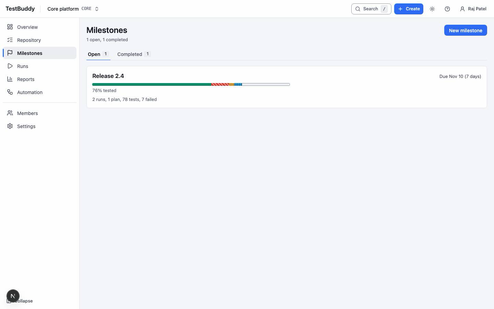
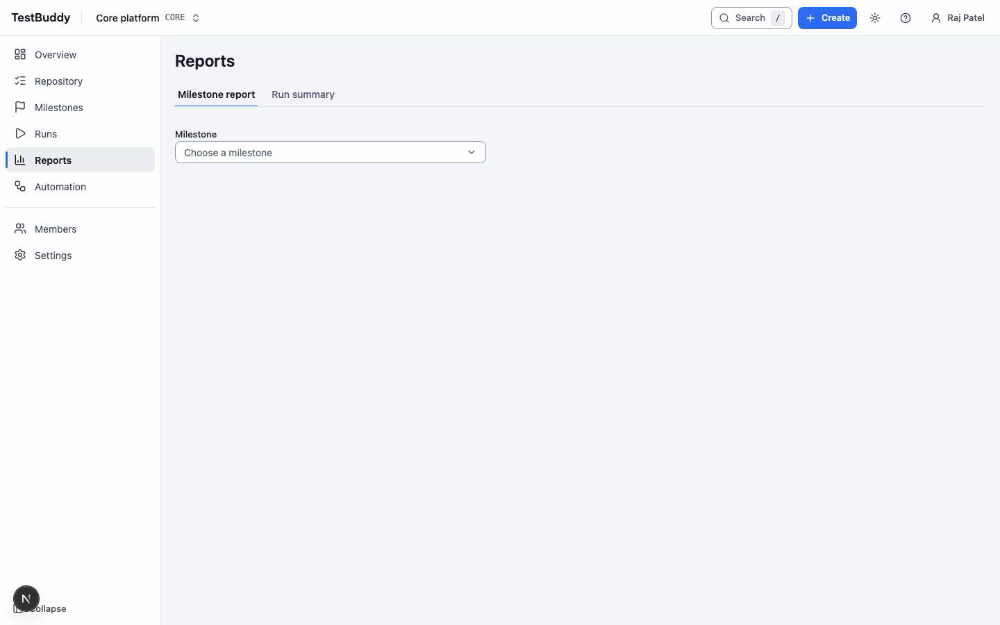

# Manager

> DRAFT. Screens are placeholders and steps may change.

Managers set release goals and decide when a release is ready.

## Milestones and plans

A milestone is a release or date goal. Plans and runs roll up into it. Open Milestones to see due dates and progress, then open a milestone to see what is still failing.

## Read the overview

The project overview shows cases, open runs, pass rate and failing tests for the last seven days, the active milestone and recent activity.

## Reports

Open Reports and choose a milestone or run report for pass rate, failures and trend. Managers and admins can export a report as CSV.

## The release call

Before the go or no-go meeting: open the milestone report, check the failing tests and any Blocked ones, and note which runs are still open.
