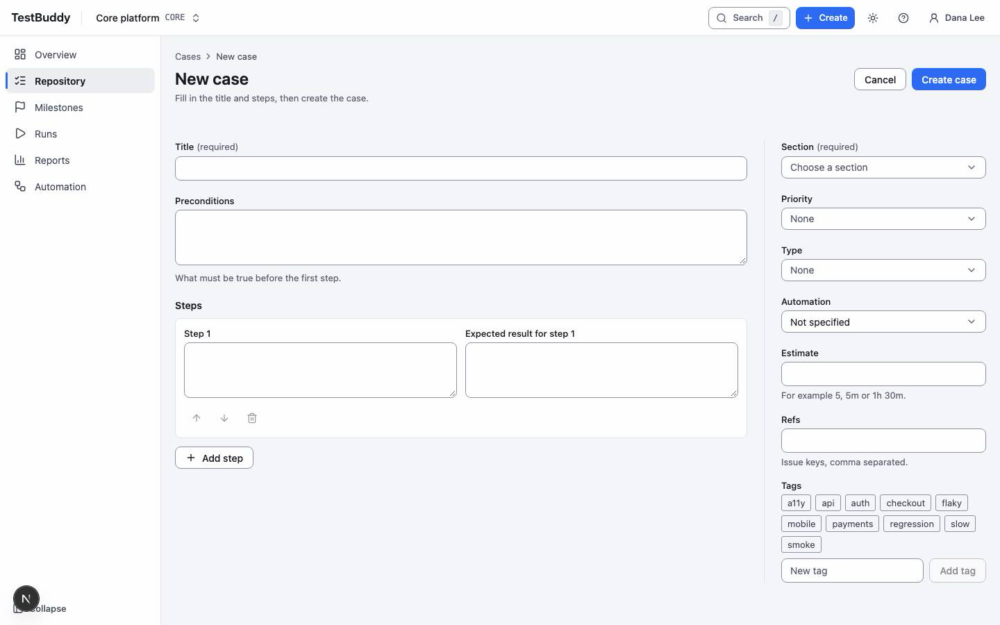
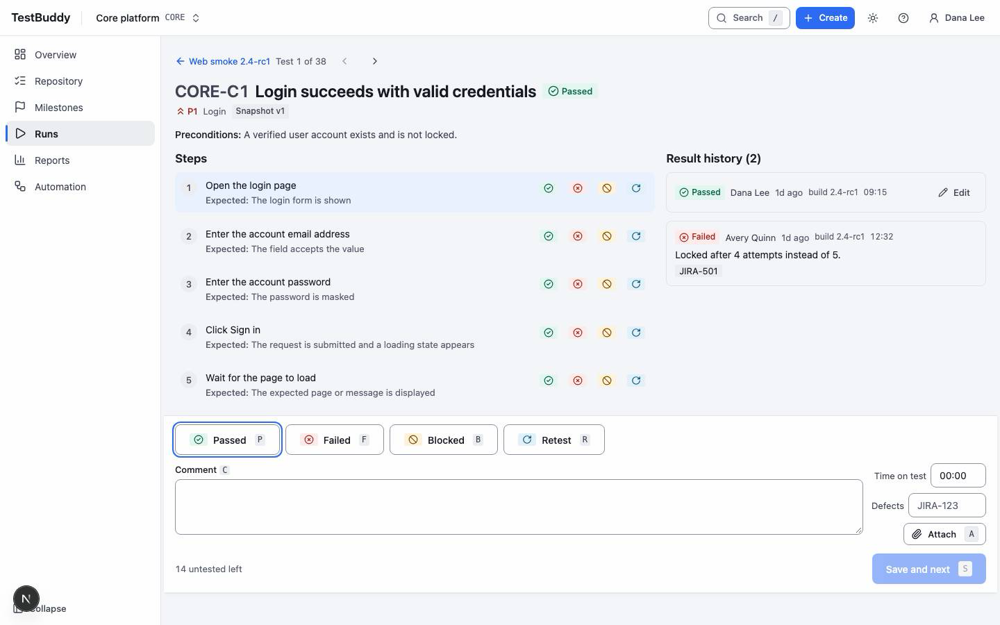

# Tester

> DRAFT. Screens are placeholders; steps follow the design spec and may change.

Testers write cases and record results.

## Write a test case

1. Open Repository in the sidebar and pick the suite and section where the case belongs.
2. Choose Create, then New case.
3. Give the case a title that says what is checked.
4. Add steps, each with an expected result.
5. Save. The case is now version 1; every later edit saves a new version.

## Run tests and record results

1. Open Runs and open the run you were assigned.
2. Open a test from the list.
3. Set the result with the buttons in the bottom bar, or with the keys.
4. Add a comment, time spent or defect link when needed. Some statuses require a comment.
5. Save and next. The result is saved and the next test opens. Undo stays available for ten seconds.

### Keys

| Key | Action |
|---|---|
| `P` `F` `B` `R` | Set Passed, Failed, Blocked, Retest |
| `N` | Jump to the next untested test |
| `J` `K` | Move down and up the list |
| `Enter` | Open the highlighted test |
| `Esc` | Close and go back to the list |

## When a result is wrong

Edit your own result while the run is open. A closed run cannot be changed.
